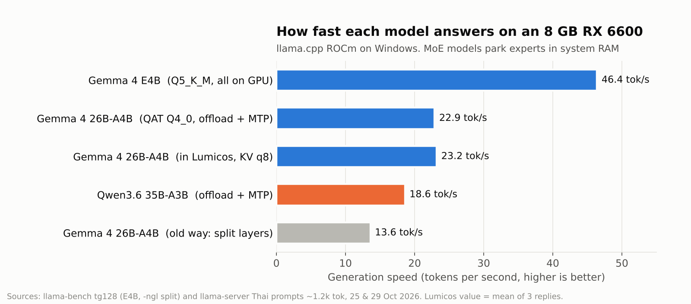
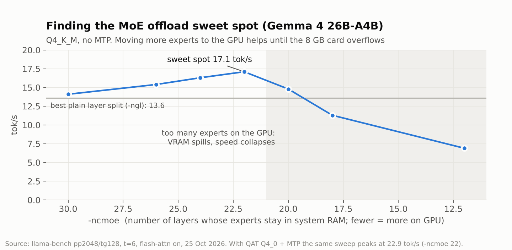
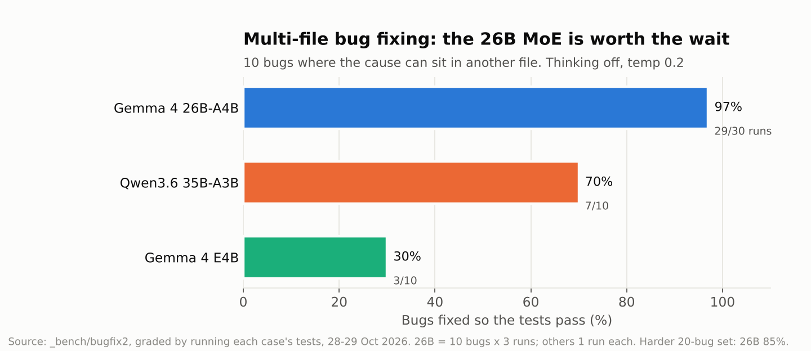
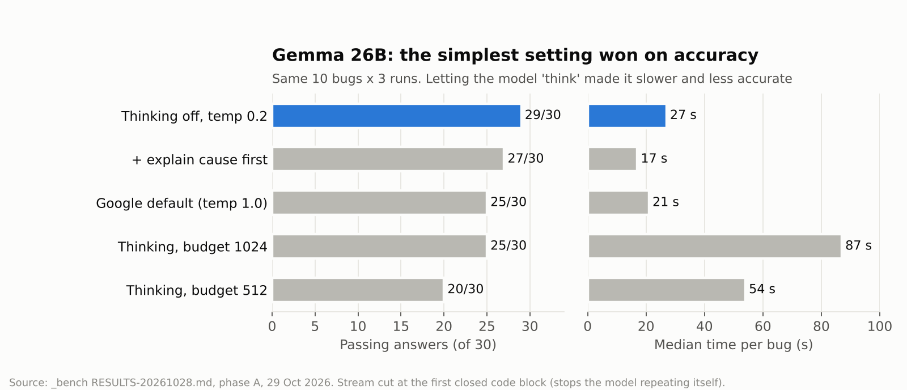
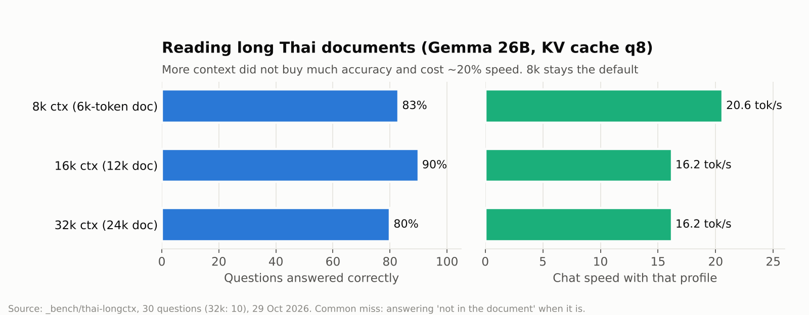
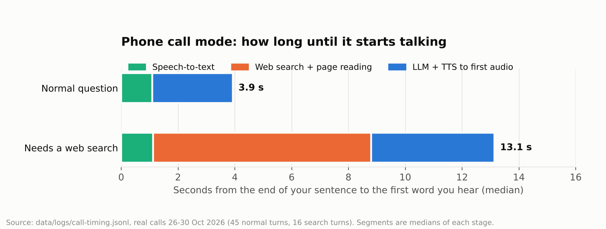
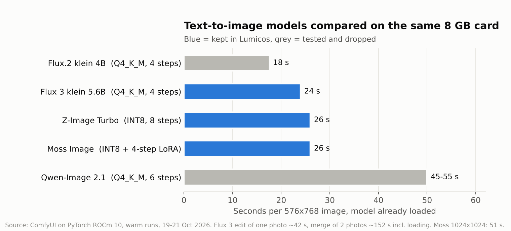
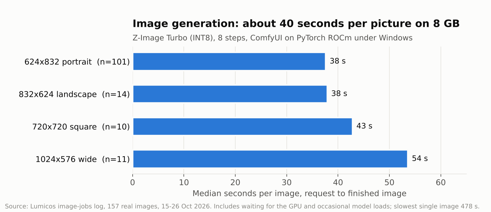
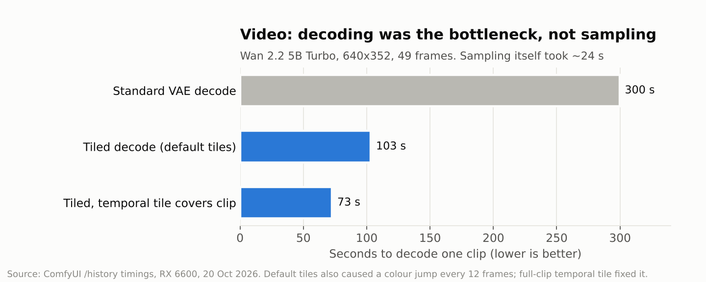
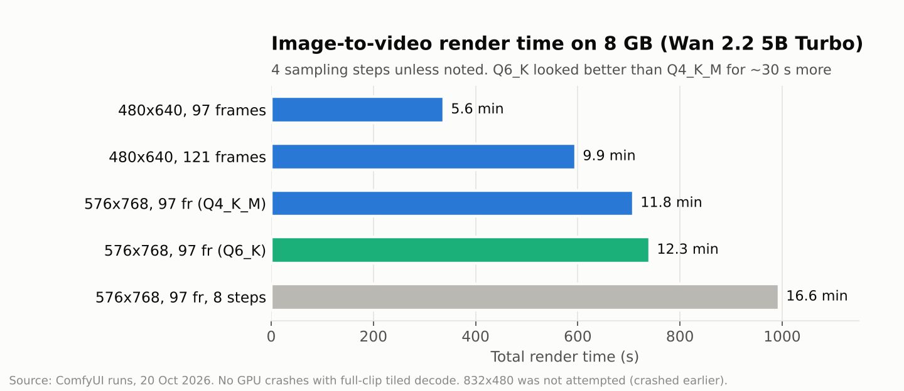

# Lumicos

[ภาษาไทย](README.th.md)

**A local-first personal AI that runs on one mid-range gaming PC.**
Chat, voice, web search, a local knowledge library, image generation and background agents, with no cloud service in the loop.

> **Status: early public snapshot (v0.2.3).** Built and tested on one machine (Windows 11, AMD RX 6600 8 GB). Expect rough edges. Some features from my day-to-day build are not in this snapshot yet (see [What's not here yet](#whats-not-here-yet)).

---

## What it can do

**Chat**
- Everyday chat with a built-in assistant ("Nova"), your own characters and a roleplay mode, and a private mode that keeps no memory and never searches
- Long-term memory you can view and edit; older messages that no longer fit the context window are recalled when relevant
- Tools the model can call: web search, a sandboxed Python runner, read/write files in your workspace (writes need approval), date/time, image generation, skills

**Voice**
- Read answers aloud and talk hands-free in a call mode (speech-to-text → LLM → text-to-speech)
- In this public build, speech output uses the Thai voice built into Windows (Microsoft Pattara) on the CPU

**Knowledge & web**
- A router decides per question: answer directly, search your local notes, search the web, or both
- A local knowledge library (Markdown notes + SQLite index) that answers can be saved into

**Images**
- Create and edit images through ComfyUI running on PyTorch **ROCm** (AMD) or CUDA (NVIDIA), Z-Image Turbo in the default install

**Background agents**
- "Research X and save it to my notes", scheduled summaries, trip plans and quizzes exported to Word/Excel
- Agents always yield the GPU to chat and calls

**Skills**
- 14 small built-in skills (VAT, loan instalments, unit conversion, Thai baht text, Thai dates, bill splitting, …); add your own as a folder with a `SKILL.md`

## How it works

```
 Browser / phone PWA (React + Vite)
          │  /api
          ▼
 Lumicos local service (Node.js, 127.0.0.1 only)
  ├─ Chat service ── prompt builder, tool router, memory, recall
  ├─ Knowledge router ── local library (SQLite) │ web search
  ├─ Agents ── queue, scheduler, document export
  ├─ Voice ── call controller, STT/TTS lifecycle
  └─ Model manager ── starts/switches llama.cpp profiles
          │
 ┌────────┼──────────────┬──────────────┬───────────────┐
 llama.cpp        whisper.cpp      Windows TTS      ComfyUI
 (CUDA/ROCm/       (STT)           (Pattara)        (PyTorch ROCm
  Vulkan/CPU)                                        or CUDA)
```

Design rules:

- **Everything is local.** Services bind to `127.0.0.1`. No telemetry, no cloud API.
- **The model never touches the disk directly.** It writes a tool request as text; the service validates the path, checks permissions, and asks before any write.
- **One GPU, many jobs.** A model manager swaps llama.cpp profiles, and background work waits while you chat or talk.
- **Code backs up the prompt.** Small models break prompt rules, so important limits (paths, permissions, private mode) are enforced in code.

## Repository layout

| Path | What it is |
|---|---|
| `payload/PersonalAI/` | the app: Node.js service (`server/`) and React UI (`src/`) |
| `payload/LumicosSearchMCP/` | web search helper (Python) |
| `payload/Lumicos-Sandbox/` | sandboxed Python runner for code execution (Windows AppContainer) |
| `payload/skills/` | built-in skills |
| `payload/custom_nodes/` | two small ComfyUI nodes that free GPU memory between jobs |
| `src/`, `catalog/`, `scripts/` | the Windows installer: hardware detection, pinned downloads, setup |
| `tests/` | installer tests |
| `docs/charts/` | benchmark charts and the script that draws them |

## Install (Windows 11, beta)

The installer detects your hardware and picks a profile:

- **NVIDIA** → llama.cpp CUDA 12.4 / 13.4 (Vulkan if the driver is too old)
- **AMD RX 6000 / 7000 / 9000** → llama.cpp ROCm with the right `gfx` target
- **Intel or unknown GPU** → Vulkan chat only; **no GPU** → CPU
- Image generation only when a CUDA/ROCm card with ≥ 8 GB is verified

It downloads pinned, checksum-verified runtimes (Node.js, uv/Python, llama.cpp, whisper.cpp, ComfyUI), sets up the sandbox, builds the app, then opens `MODELS.html` listing the models to download yourself from Hugging Face:

| Model | Size | Licence |
|---|---|---|
| Google Gemma 4 E2B-it QAT Q4_0 (calls, small PCs) | 3.1 GB | Apache-2.0 |
| Google Gemma 4 E4B-it QAT Q4_0 (chat, ≥ 12 GB VRAM) | 4.8 GB | Apache-2.0 |
| whisper large-v3-turbo q5_0 | 0.5 GB | MIT |
| Z-Image Turbo + Qwen3 4B encoder + VAE | ~19 GB | Apache-2.0 |

Free disk: 15 GB for chat + voice, 80 GB with images. Needs internet during install. Not code-signed yet, so Windows will warn you. Fully tested only on the author's PC; NVIDIA and newer AMD cards still need real-world reports.

**From source:** `Install.cmd` runs the installer from this folder. To build the single-file `Lumicos-Setup.exe`: `powershell -ExecutionPolicy Bypass -File scripts/build-launcher.ps1`. Tests: `npm test` (installer) and, inside `payload/PersonalAI`, `npm ci && npm run build` then `node --test server/test/<file>.test.mjs`.

## Benchmarks (one PC: Ryzen 5 3600, 32 GB RAM, RX 6600 8 GB)

My own runs, 20–30 Oct 2026, mostly on my day-to-day build. Small samples on one machine: a field report, not a leaderboard. Each chart names its test and date.

Everything below ran on AMD's ROCm stack under Windows: llama.cpp's ROCm/HIP build for language models and ComfyUI on PyTorch ROCm for images and video. No NVIDIA card involved.





The trick that made a 26B model usable on 8 GB: keep the Mixture-of-Experts weights in system RAM (`-ncmoe`) instead of splitting whole layers, add the MTP draft head, and use the QAT Q4_0 file so a few more experts fit on the card.

















### AI video generation: tried, then dropped

I spent a few days on Wan 2.2 5B Turbo (text-to-video and image-to-video) and stopped. On an 8 GB card a 4–5 second clip took 6 to 17 minutes, 832×480 crashed the GPU during decoding, and the results were not good enough: faces in text-to-video were poor, and image-to-video motion looked fast-forwarded rather than cinematic. Lumicos keeps editing tools for real footage (ffmpeg, DaVinci Resolve) instead of generating video.

Things that did **not** help on this card: llama.cpp `--moe-cache-mib`, letting the model "think" for coding, a DRY sampler, and 16k/32k context for everyday chat.

## What's not here yet

My day-to-day build has a few newer pieces that will come to this repo after clean-up:

- Web search *during* phone calls (with page reading for live prices) and "do it after the call" task notes
- Automatic long-term memory (notices durable facts, skips moods and one-off questions)
- Video tools (ffmpeg stabilise/colour/reformat, Thai subtitles), DaVinci Resolve control, MCP client
- Model profiles for the 26B MoE setup shown in the benchmarks

## Honest limits

- Thai-first; English works but is less tuned
- 8 GB VRAM decides a lot: voice plus a big model don't fit at once
- Small models can still be wrong; check facts that matter

## Licence

MIT for the code in this repository (see `LICENSE`). Downloaded runtimes and models keep their own licences (see `THIRD-PARTY-NOTICES.md`); the ComfyUI nodes in `payload/custom_nodes` run inside ComfyUI (GPL-3.0).
