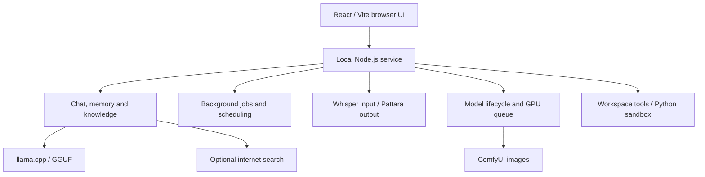

<p align="center"></p>

# Lumicos

**Your AI. Your Machine. Your Control.**

A local-first AI assistant for Windows, built to make powerful AI accessible on everyday hardware.

[](LICENSE)

[](https://github.com/Lumicos/lumicos)

[ภาษาไทย](README.th.md) · [Install guide](docs/INSTALLATION.md) · [Feature status](docs/FEATURE_STATUS.md)

Chat with local GGUF models, keep editable memories and notes, and read replies aloud with Microsoft Pattara. The public source also includes experimental voice calls, ComfyUI image workflows and background research jobs.

> **Experimental Windows installer, v0.2.3-beta.** [Download the Pre-release](https://github.com/Lumicos/lumicos/releases/tag/v0.2.3-beta). **This installer has never been tested on another computer.** A complete fresh installation with runtime/model downloads has not been validated. Unsigned; not hardware compatibility certification.

## Demo

A verified screenshot or recording is still needed. See the [capture guide](docs/DEMO_CAPTURE_GUIDE.md); existing benchmark charts are measurements, not screenshots of the app.

## Why Lumicos?

**Built and tested on an AMD RX 6600 8GB — because local AI shouldn't require a workstation GPU.**

The developer's reference machine is a Ryzen 5 3600, RX 6600 8GB and 32GB RAM running Windows 11 with ROCm. That history includes a private daily build; it is not a clean-install test of every public feature.

- Keep model inference and application data on your own machine.
- Coordinate chat, image jobs and background work on one GPU.
- Inspect the source, model settings and saved memory.

Downloads and optional web search require internet. The Python sandbox can access the public internet. “Local-first” does not mean every operation is offline.

## Features

- **Local chat:** llama.cpp model management, GGUF files, Nova assistant and conversation history.
- **Memory and knowledge:** editable memories, recall, Markdown knowledge library and routing between local notes and optional web search.
- **Voice:** CPU speech output using **Microsoft Pattara only**; Whisper input and call orchestration are experimental.
- **Images and agents:** experimental ComfyUI workflows, research/scheduled jobs and document exports.
- **Tools:** workspace file operations, Windows AppContainer Python sandbox and 14 bundled utility skills.

See [Feature status](docs/FEATURE_STATUS.md) for source/test evidence, configuration gates and features that are **not included**, including a general MCP client and DaVinci Resolve integration.

## Hardware compatibility

| Hardware | Installer selection | Evidence level |
|---|---|---|
| RX 6600 8GB | ROCm / gfx1032; CPU Whisper | Developer reference machine; public clean install pending |
| Recognized RX 6000/7000/9000 | ROCm target selected by model | Detection logic tested, not certification |
| NVIDIA | CUDA 12.4/13.4 or Vulkan fallback | Driver-dependent selection; target-machine tests needed |
| Other GPU / no GPU | Vulkan chat / CPU chat | Availability and speed require validation |

Image setup and the chat E4B model both require a recognized CUDA/ROCm GPU with approximately 8GiB dedicated VRAM (the selector uses a 7.5GiB threshold so cards that report slightly under 8GiB still qualify; below that, chat uses E2B). NVIDIA CUDA 13 binaries are selected when the driver reports CUDA 13.0 or newer (RTX 50-series / Blackwell is not eligible for the CUDA 12.4 build). Not every model fits in 8GB: larger models may use CPU/RAM offloading. Quantization, context, model architecture and configuration all affect performance. See [installation details](docs/INSTALLATION.md).

## Quick start

Windows 11 x64 is required. Use a new folder, keep enough disk space, and do not install over an existing personal setup.

**One-line install (CMD / PowerShell — no manual ZIP download):**

```bat
powershell -NoProfile -ExecutionPolicy Bypass -Command "irm https://raw.githubusercontent.com/Lumicos/lumicos/main/install.ps1 | iex"
```

That fetches [`install.ps1`](install.ps1), downloads the public `main` ZIP into `%TEMP%`, runs [`Install.cmd`](Install.cmd) with the interactive console attached, then cleans temp files on success. Repo must stay **public** for unauthenticated `raw.githubusercontent.com` / ZIP URLs. No admin elevation is requested by the bootstrap script itself.

**Or clone, then install:**

```powershell
git clone https://github.com/Lumicos/lumicos.git
cd lumicos
.\Install.cmd
```

Review the detected hardware and destination. The installer downloads its runtimes. Interactively, choose which models to prepare (chat, Whisper, TTS, Z-Image); declining skips that model and continues. If STT is kept on a CPU-Whisper profile, you can accept CPU Whisper or skip STT — neither choice aborts the install. Use `--yes` for defaults, `--skip-images / --skip-stt / --skip-tts` / `-SkipImages` to omit Image Lab (hides that page in the app), or `--models=…` to pin a list. After setup, review `MODELS.html`, download the selected models, run `Link Downloaded Models.cmd` if downloading manually, then `Check Installation.cmd` and `Start Lumicos.cmd` in the installed folder.

**Before installing:** read the [known issues and prerequisites](docs/INSTALLATION.md). A successful source test or EXE extraction is not a successful clean install. [Release checklist](docs/RELEASE_CHECKLIST.md).

## Model support

The [model catalog](catalog/models.json) pins Gemma 4 E2B/E4B GGUF, Whisper large-v3-turbo and the default Z-Image components. Weights are separate downloads; read the upstream model terms. Other GGUF files depend on the bundled llama.cpp build and the model's capabilities. The 26B/MTP profiles shown in developer benchmarks are not supplied as ready-to-use public profiles.

## Architecture overview



Source entry points and trust boundaries are in [Feature status](docs/FEATURE_STATUS.md) and [Security](SECURITY.md).

## Benchmarks

Existing developer results include **46.4 tok/s** for E4B Q5_K_M (`llama-bench tg128`) and **22.9 tok/s** for a 26B QAT Q4_0 offload + MTP configuration (`llama-server`). These are different workloads, not an apples-to-apples ranking or public-install guarantee. [Methods, existing charts and missing raw-data caveats](docs/BENCHMARKS.md).

## Current limitations

Thai-first; small models still make mistakes. Full calls, images, scheduling and sandbox setup need end-to-end validation on fresh machines. Optional knowledge embedding components need their own model/runtime preparation. There is no official macOS/Linux installer, signed public EXE, or complete clean-install validation in this review. [Known issues](docs/INSTALLATION.md).

## Roadmap

Proposed next steps, not delivered features: clean-install evidence on AMD/NVIDIA/CPU, reviewed screenshots, broader model/configuration tests and clearer setup diagnostics. General MCP, Resolve control, automatic durable-memory capture and newer call features remain outside this public snapshot. [Status and release gates](docs/FEATURE_STATUS.md).

## Contributing

Read [CONTRIBUTING.md](CONTRIBUTING.md). Bug, feature and hardware report templates are included. Please use synthetic examples and redact logs. [Code of conduct](CODE_OF_CONDUCT.md).

## Security

Read [SECURITY.md](SECURITY.md) before sharing a vulnerability. Do not post credentials, private chats or exploit details in a public issue. Private reporting still needs maintainer activation.

## License

Repository code is [MIT](LICENSE). Downloaded runtimes, models and components retain their own terms; see [third-party notices](THIRD-PARTY-NOTICES.md). A code license does not grant rights to model weights.
