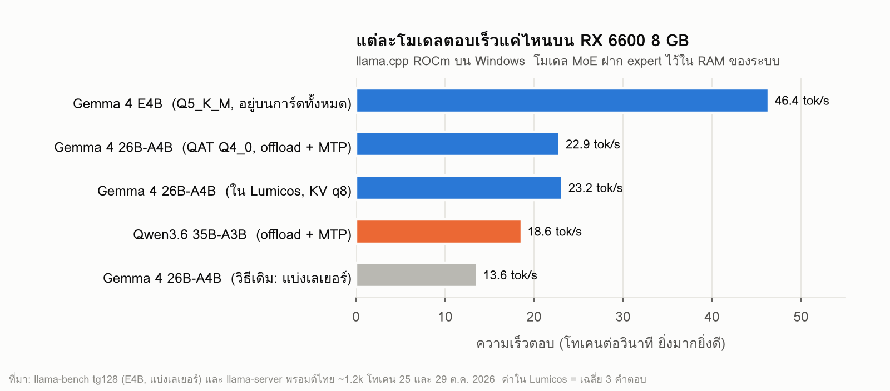
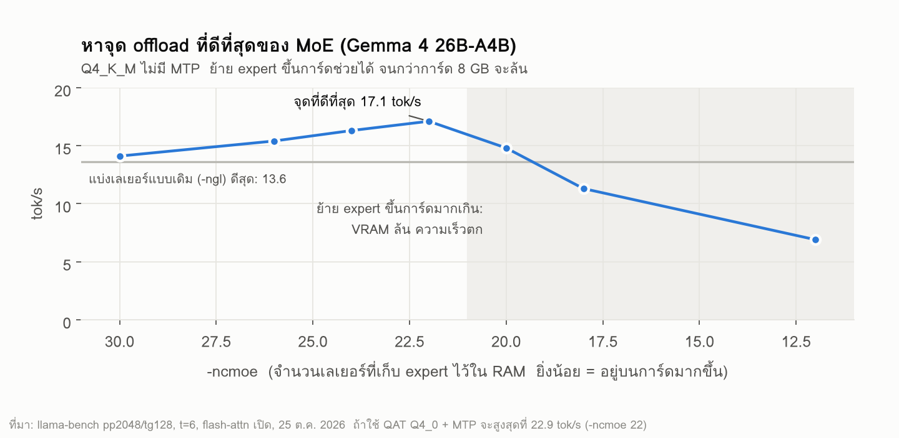
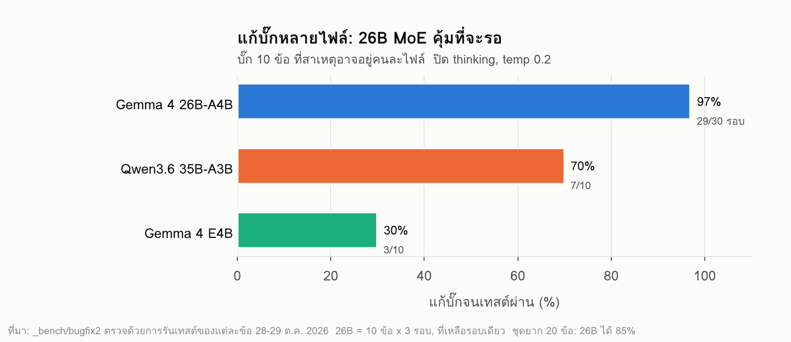
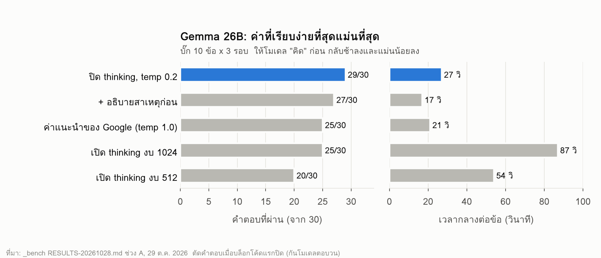
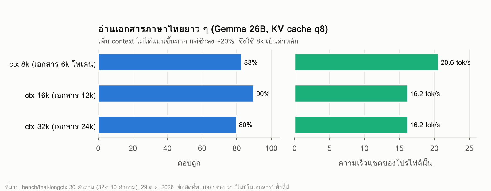
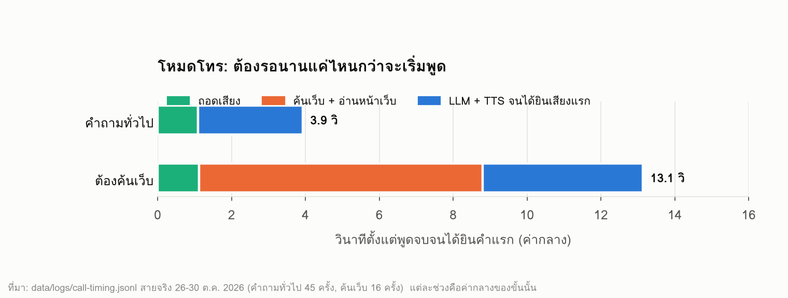
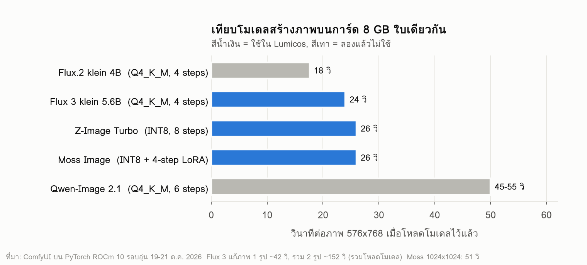
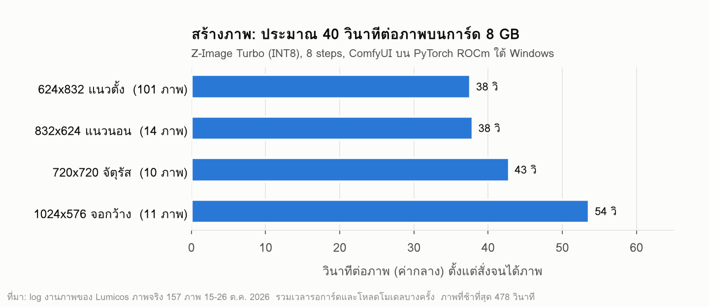
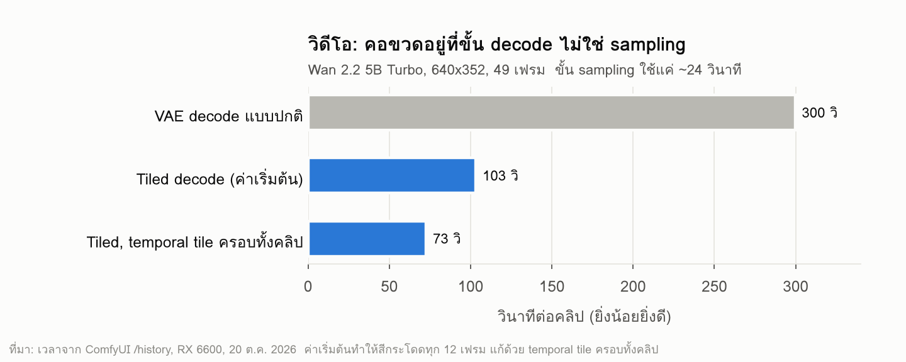
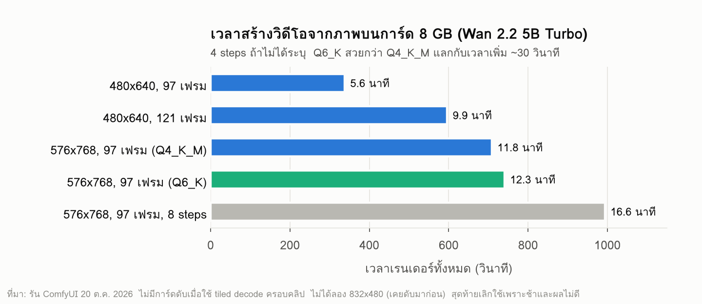

# Lumicos

[English](README.md)

**AI ส่วนตัวที่รันในเครื่องทั้งหมด บนคอมเล่นเกมสเปกกลาง ๆ เครื่องเดียว**
แชต คุยด้วยเสียง ค้นเว็บ คลังความรู้ในเครื่อง สร้างภาพ และผู้ช่วยทำงานเบื้องหลัง โดยไม่ต้องพึ่งบริการคลาวด์

> **สถานะ: เวอร์ชันเผยแพร่แรก (v0.2.3)** สร้างและทดสอบบนเครื่องเดียว (Windows 11, AMD RX 6600 8 GB) อาจยังมีจุดหยาบอยู่ ฟีเจอร์ใหม่บางอย่างที่ใช้อยู่ในเครื่องผู้พัฒนายังไม่อยู่ในชุดนี้ (ดู [สิ่งที่ยังไม่มีในชุดนี้](#สิ่งที่ยังไม่มีในชุดนี้))

---

## ทำอะไรได้บ้าง

**แชต**
- คุยทั่วไปกับผู้ช่วยในตัวชื่อ "Nova" สร้างตัวละครเอง โหมดโรลเพลย์ และโหมดส่วนตัวที่ไม่จำอะไรและไม่ค้นเว็บ
- ความจำระยะยาวที่ดูและแก้ไขได้ และดึงข้อความเก่าที่ล้นหน้าต่างบริบทกลับมาเมื่อเกี่ยวข้อง
- เครื่องมือที่โมเดลเรียกใช้ได้: ค้นเว็บ, รัน Python ในแซนด์บ็อกซ์, อ่าน/เขียนไฟล์ในโฟลเดอร์งาน (เขียนต้องขออนุญาตก่อน), วันเวลา, สร้างภาพ, skills

**เสียง**
- อ่านคำตอบออกเสียง และโหมดโทรคุยแบบไม่ต้องใช้มือ (ถอดเสียง → LLM → สังเคราะห์เสียง)
- ในชุดเผยแพร่นี้ใช้เสียงภาษาไทยของ Windows (Microsoft Pattara) บน CPU

**ความรู้และเว็บ**
- ตัวตัดสินเส้นทางเลือกเองในแต่ละคำถาม ว่าจะตอบเลย ค้นโน้ตในเครื่อง ค้นเว็บ หรือทั้งสองอย่าง
- คลังความรู้ในเครื่อง (โน้ต Markdown + ดัชนี SQLite) บันทึกคำตอบเข้าไปได้

**ภาพ**
- สร้างและแก้ภาพผ่าน ComfyUI ที่รันบน PyTorch **ROCm** (AMD) หรือ CUDA (NVIDIA) ค่าเริ่มต้นใช้ Z-Image Turbo

**ผู้ช่วยทำงานเบื้องหลัง**
- "ค้นเรื่อง X แล้วเก็บเข้าโน้ต", สรุปตามเวลาที่ตั้ง, วางแผนเที่ยวและทำข้อสอบส่งออกเป็น Word/Excel
- งานเบื้องหลังหลีกทางให้แชตและการโทรเสมอ

**Skills**
- skill เล็ก ๆ ในตัว 14 ชุด (VAT, ผ่อนชำระ, แปลงหน่วย, เงินบาทเป็นตัวหนังสือ, วันที่ไทย, หารค่าอาหาร ฯลฯ) เพิ่มเองได้ด้วยโฟลเดอร์ที่มี `SKILL.md`

## ทำงานอย่างไร

```
 เบราว์เซอร์ / PWA บนมือถือ (React + Vite)
          │  /api
          ▼
 บริการ Lumicos ในเครื่อง (Node.js, 127.0.0.1 เท่านั้น)
  ├─ แชต ── ประกอบพรอมต์, ส่งงานให้เครื่องมือ, ความจำ, ดึงข้อความเก่า
  ├─ ตัวตัดสินเส้นทางความรู้ ── คลังในเครื่อง (SQLite) │ ค้นเว็บ
  ├─ ผู้ช่วยเบื้องหลัง ── คิว, ตั้งเวลา, ส่งออกเอกสาร
  ├─ เสียง ── ควบคุมการโทร, เปิด/ปิด STT/TTS
  └─ จัดการโมเดล ── เปิด/สลับโปรไฟล์ llama.cpp
          │
 ┌────────┼──────────────┬──────────────┬───────────────┐
 llama.cpp        whisper.cpp      Windows TTS      ComfyUI
 (CUDA/ROCm/       (ถอดเสียง)       (Pattara)        (PyTorch ROCm
  Vulkan/CPU)                                        หรือ CUDA)
```

หลักที่ใช้ออกแบบ:

- **ทุกอย่างอยู่ในเครื่อง** บริการผูกกับ `127.0.0.1` ไม่มีการเก็บสถิติ ไม่เรียก API คลาวด์
- **โมเดลแตะดิสก์เองไม่ได้** โมเดลเขียนคำขอเป็นข้อความ บริการตรวจ path ตรวจสิทธิ์ และถามก่อนเขียนไฟล์ทุกครั้ง
- **การ์ดจอใบเดียว หลายงาน** ตัวจัดการโมเดลสลับโปรไฟล์ llama.cpp และงานเบื้องหลังรอระหว่างที่คุณแชตหรือโทร
- **โค้ดคุมแทนพรอมต์** โมเดลเล็กมักไม่ทำตามกฎในพรอมต์ ข้อจำกัดสำคัญ (path, สิทธิ์, โหมดส่วนตัว) จึงบังคับในโค้ด

## โครงสร้างรีโป

| ที่อยู่ | คืออะไร |
|---|---|
| `payload/PersonalAI/` | ตัวแอป: บริการ Node.js (`server/`) และหน้าจอ React (`src/`) |
| `payload/LumicosSearchMCP/` | ตัวช่วยค้นเว็บ (Python) |
| `payload/Lumicos-Sandbox/` | ตัวรัน Python แบบแซนด์บ็อกซ์ (Windows AppContainer) |
| `payload/skills/` | skills ในตัว |
| `payload/custom_nodes/` | โหนด ComfyUI เล็ก ๆ 2 ตัวที่คืนหน่วยความจำการ์ดจอระหว่างงาน |
| `src/`, `catalog/`, `scripts/` | ตัวติดตั้ง Windows: ตรวจฮาร์ดแวร์, ดาวน์โหลดแบบตรึงเวอร์ชัน, ตั้งค่า |
| `tests/` | เทสต์ของตัวติดตั้ง |
| `docs/charts/` | กราฟเบนช์มาร์กและสคริปต์ที่ใช้วาด |

## ติดตั้ง (Windows 11, เบต้า)

ตัวติดตั้งตรวจฮาร์ดแวร์แล้วเลือกโปรไฟล์ให้:

- **NVIDIA** → llama.cpp CUDA 12.4 / 13.4 (ใช้ Vulkan ถ้าไดรเวอร์เก่าเกินไป)
- **AMD RX 6000 / 7000 / 9000** → llama.cpp ROCm พร้อม `gfx` ที่ตรงรุ่น
- **Intel หรือการ์ดที่ไม่รู้จัก** → แชตผ่าน Vulkan อย่างเดียว; **ไม่มีการ์ดจอ** → CPU
- สร้างภาพได้เฉพาะเมื่อตรวจพบการ์ด CUDA/ROCm ที่มี VRAM ตั้งแต่ 8 GB

ตัวติดตั้งดาวน์โหลดโปรแกรมที่ตรึงเวอร์ชันและตรวจ checksum (Node.js, uv/Python, llama.cpp, whisper.cpp, ComfyUI), ตั้งแซนด์บ็อกซ์, build แอป แล้วเปิดหน้า `MODELS.html` ที่บอกรายการโมเดลให้ดาวน์โหลดเองจาก Hugging Face:

| โมเดล | ขนาด | ใบอนุญาต |
|---|---|---|
| Google Gemma 4 E2B-it QAT Q4_0 (โหมดโทร, เครื่องเล็ก) | 3.1 GB | Apache-2.0 |
| Google Gemma 4 E4B-it QAT Q4_0 (แชต, VRAM ≥ 12 GB) | 4.8 GB | Apache-2.0 |
| whisper large-v3-turbo q5_0 | 0.5 GB | MIT |
| Z-Image Turbo + ตัวเข้ารหัส Qwen3 4B + VAE | ~19 GB | Apache-2.0 |

พื้นที่ว่าง: 15 GB สำหรับแชตกับเสียง, 80 GB ถ้ารวมสร้างภาพ ต้องต่ออินเทอร์เน็ตระหว่างติดตั้ง ยังไม่มีลายเซ็นดิจิทัล Windows จะเตือน ทดสอบครบเฉพาะเครื่องผู้พัฒนา การ์ด NVIDIA และ AMD รุ่นใหม่ยังต้องการผลจากผู้ใช้จริง

**ติดตั้งจากซอร์ส:** `Install.cmd` รันตัวติดตั้งจากโฟลเดอร์นี้ ถ้าจะ build เป็นไฟล์เดียว `Lumicos-Setup.exe`: `powershell -ExecutionPolicy Bypass -File scripts/build-launcher.ps1` เทสต์: `npm test` (ตัวติดตั้ง) และใน `payload/PersonalAI` รัน `npm ci && npm run build` แล้ว `node --test server/test/<ไฟล์>.test.mjs`

## เบนช์มาร์ก (เครื่องเดียว: Ryzen 5 3600, RAM 32 GB, RX 6600 8 GB)

ผลที่วัดเองช่วง 20–30 ต.ค. 2026 ส่วนใหญ่วัดบนเวอร์ชันที่ใช้งานประจำ ตัวอย่างน้อยและมีเครื่องเดียว ให้ถือเป็นบันทึกจากการใช้งานจริง ไม่ใช่ตารางจัดอันดับ ใต้กราฟทุกรูปบอกวิธีวัดและวันที่

ทุกอย่างรันบน ROCm ของ AMD ใต้ Windows: llama.cpp รุ่น ROCm/HIP สำหรับโมเดลภาษา และ ComfyUI บน PyTorch ROCm สำหรับภาพและวิดีโอ ไม่ได้ใช้การ์ด NVIDIA เลย





เคล็ดลับที่ทำให้โมเดล 26B ใช้งานได้บนการ์ด 8 GB: เก็บน้ำหนักส่วน Mixture-of-Experts ไว้ใน RAM ของระบบ (`-ncmoe`) แทนการแบ่งทั้งเลเยอร์, ใช้หัว MTP ช่วยเดาคำ และใช้ไฟล์ QAT Q4_0 ที่เล็กลงจนใส่ expert บนการ์ดได้มากขึ้น

















### สร้างวิดีโอด้วย AI: ลองแล้ว เลิกใช้

ลอง Wan 2.2 5B Turbo (สร้างวิดีโอจากข้อความและจากภาพ) อยู่หลายวันแล้วเลิก บนการ์ด 8 GB คลิปยาว 4–5 วินาทีใช้เวลา 6 ถึง 17 นาที ความละเอียด 832×480 ทำให้การ์ดจอดับตอนถอดภาพ และผลลัพธ์ยังไม่ดีพอ: วิดีโอจากข้อความได้หน้าคนไม่สวย ส่วนวิดีโอจากภาพเคลื่อนไหวเหมือนกดเร่งสปีด ไม่เหมือนภาพยนตร์ Lumicos จึงเน้นเครื่องมือตัดต่อฟุตเทจจริง (ffmpeg, DaVinci Resolve) แทนการสร้างวิดีโอ

สิ่งที่ลองแล้ว**ไม่ช่วย**บนการ์ดนี้: `--moe-cache-mib` ของ llama.cpp, ให้โมเดล "คิด" ก่อนตอบงานโค้ด, DRY sampler และ context 16k/32k สำหรับแชตทั่วไป

## สิ่งที่ยังไม่มีในชุดนี้

เวอร์ชันที่ผู้พัฒนาใช้ประจำมีของใหม่บางส่วนที่จะตามมาหลังเก็บกวาดโค้ด:

- ค้นเว็บ *ระหว่างโทร* (อ่านหน้าเว็บเพื่อเอาราคาสด) และจดงาน "ไว้ทำหลังวางสาย"
- ความจำระยะยาวอัตโนมัติ (จำข้อเท็จจริงถาวร ไม่จำอารมณ์หรือคำถามครั้งเดียว)
- เครื่องมือวิดีโอ (ffmpeg กันสั่น/ปรับสี/เปลี่ยนสัดส่วน, ซับไทย), ควบคุม DaVinci Resolve, ตัวเชื่อม MCP
- โปรไฟล์โมเดล 26B MoE ตามที่ใช้ในเบนช์มาร์ก

## ข้อจำกัดตามจริง

- เน้นภาษาไทยเป็นหลัก ภาษาอังกฤษใช้ได้แต่ปรับมาน้อยกว่า
- VRAM 8 GB เป็นตัวกำหนดหลายอย่าง: เสียงกับโมเดลใหญ่ใส่พร้อมกันไม่ได้
- โมเดลเล็กยังตอบผิดได้ เรื่องสำคัญควรตรวจซ้ำ

## ใบอนุญาต

โค้ดในรีโปนี้ใช้ MIT (ดู `LICENSE`) โปรแกรมและโมเดลที่ดาวน์โหลดมาใช้ใบอนุญาตของตัวเอง (ดู `THIRD-PARTY-NOTICES.md`) ส่วนโหนดใน `payload/custom_nodes` ทำงานภายใน ComfyUI (GPL-3.0)
