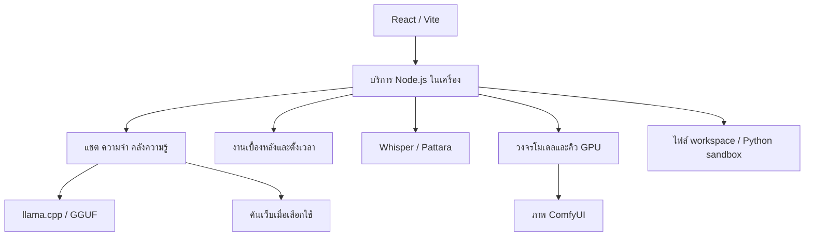

<p align="center"></p>

# Lumicos

**Your AI. Your Machine. Your Control.**

ผู้ช่วย AI แบบ local-first สำหรับ Windows เพื่อให้ใช้ AI บนคอมพิวเตอร์ทั่วไปได้ง่ายขึ้น

[](LICENSE)

[](https://github.com/Lumicos/lumicos)

[English](README.md) · [คู่มือติดตั้ง](docs/INSTALLATION.md) · [สถานะฟีเจอร์](docs/FEATURE_STATUS.md)

คุยกับโมเดล GGUF ในเครื่อง เก็บความจำและโน้ตที่แก้ไขได้ และอ่านคำตอบด้วย Microsoft Pattara ซอร์ส public ยังมีระบบทดลองสำหรับโทรคุย สร้างภาพผ่าน ComfyUI และงานค้นคว้าเบื้องหลัง

> **ตัวติดตั้ง Windows รุ่นทดลอง v0.2.3-beta** [ดาวน์โหลด Pre-release](https://github.com/Lumicos/lumicos/releases/tag/v0.2.3-beta) **ยังไม่เคยทดสอบติดตั้งบนเครื่องอื่น** และยังไม่ยืนยันการติดตั้งใหม่ครบพร้อม runtime/โมเดล ไฟล์ไม่ได้เซ็นชื่อและไม่ใช่การรับรองฮาร์ดแวร์ทุกเครื่อง

## เดโม

ยังต้องถ่าย screenshot หรือวิดีโอจากโปรแกรมจริง ดู [แนวทางถ่ายเดโม](docs/DEMO_CAPTURE_GUIDE.md) กราฟ benchmark ที่มีอยู่ไม่ใช่ภาพหน้าจอแอป

## ทำไม Lumicos?

**สร้างและทดสอบบน AMD RX 6600 8GB เพราะ Local AI ไม่ควรจำเป็นต้องใช้การ์ดระดับเวิร์กสเตชัน**

เครื่องอ้างอิงของผู้พัฒนา: Ryzen 5 3600, RX 6600 8GB, RAM 32GB, Windows 11 และ ROCm ประวัติการทดสอบนี้รวมระบบส่วนตัวที่ใช้งานประจำ จึงไม่ใช่หลักฐาน clean install ของทุกฟีเจอร์ public

- ประมวลผลโมเดลและเก็บข้อมูลแอปในเครื่อง
- จัดการแชต งานภาพ และงานเบื้องหลังบน GPU ใบเดียว
- ตรวจซอร์ส การตั้งโมเดล และความจำที่บันทึกได้

การดาวน์โหลดและค้นเว็บต้องใช้อินเทอร์เน็ต Python sandbox เข้าถึงอินเทอร์เน็ตสาธารณะได้ คำว่า local-first ไม่ได้แปลว่าทุกการทำงานออฟไลน์

## ฟีเจอร์

- **แชตในเครื่อง:** จัดการ llama.cpp, ไฟล์ GGUF, ผู้ช่วย Nova และประวัติสนทนา
- **ความจำและคลังความรู้:** แก้ไขความจำ เรียกคืนข้อความ คลัง Markdown และเลือกค้นโน้ตหรือเว็บ
- **เสียง:** ใช้ **Microsoft Pattara เท่านั้น** บน CPU; Whisper และระบบโทรยังเป็น experimental
- **ภาพและเอเจนต์:** ComfyUI งานค้นคว้า/ตั้งเวลา และส่งออกเอกสารยังเป็น experimental
- **เครื่องมือ:** จัดการไฟล์ใน workspace, Python sandbox แบบ Windows AppContainer และ skill 14 ชุด

ดูหลักฐาน ข้อจำกัด และสิ่งที่ **ยังไม่รวม** เช่น general MCP client และ DaVinci Resolve ใน [สถานะฟีเจอร์](docs/FEATURE_STATUS.md)

## ฮาร์ดแวร์

| ฮาร์ดแวร์ | ตัวเลือกของ installer | ระดับหลักฐาน |
|---|---|---|
| RX 6600 8GB | ROCm / gfx1032; Whisper บน CPU | เครื่องผู้พัฒนา; ยังไม่ยืนยัน public clean install |
| RX 6000/7000/9000 ที่รู้จัก | เลือก ROCm target ตามรุ่น | ทดสอบตรรกะเลือก ไม่ใช่รับรองทุกการ์ด |
| NVIDIA | CUDA 12.4/13.4 หรือ Vulkan | ขึ้นกับไดรเวอร์; ต้องทดสอบบนเครื่องจริง |
| GPU อื่น / ไม่มี GPU | แชต Vulkan / CPU | ต้องตรวจการทำงานและความเร็ว |

ตั้งค่าภาพเมื่อเป็น CUDA/ROCm ที่รู้จักและ VRAM ราว 8GiB ขึ้นไป (โค้ดใช้เกณฑ์ 7.5GiB) โมเดลทุกตัวไม่ได้ใส่ใน VRAM 8GB ได้ บางตัวต้อง offload ไป CPU/RAM ความเร็วขึ้นกับ quantization, context, สถาปัตยกรรมโมเดลและค่าตั้ง ดู [รายละเอียดติดตั้ง](docs/INSTALLATION.md)

## เริ่มใช้งาน

ต้องเป็น Windows 11 x64 เลือกโฟลเดอร์ใหม่และมีพื้นที่พอ ห้ามติดตั้งทับระบบส่วนตัวที่ใช้อยู่

```powershell
git clone https://github.com/Lumicos/lumicos.git
cd lumicos
.\Install.cmd
```

ตรวจฮาร์ดแวร์และปลายทางที่แสดง Installer จะดาวน์โหลด runtime และอาจให้ยอมรับ Whisper บน CPU หลังติดตั้งอ่าน `MODELS.html` ดาวน์โหลดโมเดล ถ้าดาวน์โหลดเองให้รัน `Link Downloaded Models.cmd` จากนั้น `Check Installation.cmd` และ `Start Lumicos.cmd` ในโฟลเดอร์ที่ติดตั้ง

**อ่านก่อนติดตั้ง:** [ข้อจำกัดและสิ่งที่ต้องเตรียม](docs/INSTALLATION.md) การทดสอบซอร์สหรือแตก EXE ผ่านไม่ได้แปลว่า clean install ผ่านแล้ว ดู [release checklist](docs/RELEASE_CHECKLIST.md)

## โมเดล

[Catalog](catalog/models.json) ตรึง Gemma 4 E2B/E4B GGUF, Whisper large-v3-turbo และชุด Z-Image เริ่มต้น ต้องดาวน์โหลด weights แยกและอ่านเงื่อนไขเจ้าของโมเดล GGUF อื่นขึ้นกับความสามารถของ llama.cpp ที่แนบ โปรไฟล์ 26B/MTP ใน benchmark ยังไม่ใช่โปรไฟล์ public พร้อมใช้

## โครงสร้าง



ดูไฟล์ต้นทางและขอบเขตความปลอดภัยใน [สถานะฟีเจอร์](docs/FEATURE_STATUS.md) และ [Security](SECURITY.md)

## Benchmark

ตัวเลขเดิมที่ผู้พัฒนาเผยแพร่มี E4B Q5_K_M **46.4 tok/s** จาก `llama-bench tg128` และ 26B QAT Q4_0 offload + MTP **22.9 tok/s** จาก `llama-server` วิธีวัดต่างกัน จึงไม่ใช่การจัดอันดับแบบเทียบตรงหรือรับประกัน public installer ดู [วิธีวัด กราฟเดิม และข้อจำกัดข้อมูลดิบ](docs/BENCHMARKS.md)

## ข้อจำกัดปัจจุบัน

เน้นภาษาไทย โมเดลเล็กยังตอบผิดได้ ระบบโทร ภาพ ตารางงาน และ sandbox ต้องตรวจ end-to-end บนเครื่องใหม่ ส่วน embedding ของ knowledge ต้องเตรียมโมเดล/runtime เพิ่ม ยังไม่มี installer macOS/Linux ทางการ ไม่มี public EXE ที่เซ็นชื่อ และยังไม่ยืนยัน clean install ในการตรวจรอบนี้ ดู [ข้อจำกัด](docs/INSTALLATION.md)

## แผนต่อไป

ข้อเสนอที่ยังไม่เสร็จ: หลักฐาน clean install บน AMD/NVIDIA/CPU, ภาพแอปจริง, ทดสอบหลายโมเดล/ค่าตั้ง และข้อความวิเคราะห์ปัญหาติดตั้ง General MCP, Resolve, การเก็บ durable memory อัตโนมัติ และฟีเจอร์โทรรุ่นใหม่ยังไม่รวมใน public snapshot ดู [สถานะและเงื่อนไข release](docs/FEATURE_STATUS.md)

## ร่วมพัฒนา

อ่าน [CONTRIBUTING.md](CONTRIBUTING.md) มี template แจ้งบั๊ก เสนอฟีเจอร์ และรายงานฮาร์ดแวร์ ใช้ข้อมูลสมมติและลบข้อมูลส่วนตัวจาก log ดู [จรรยาบรรณชุมชน](CODE_OF_CONDUCT.md)

## ความปลอดภัย

อ่าน [SECURITY.md](SECURITY.md) ก่อนแจ้งช่องโหว่ ห้ามใส่ credentials, แชตส่วนตัว หรือรายละเอียดโจมตีใน public issue ผู้ดูแลยังต้องเปิดช่องแจ้งส่วนตัว

## ใบอนุญาต

โค้ดในรีโปใช้ [MIT](LICENSE) Runtime โมเดล และส่วนประกอบอื่นคงเงื่อนไขของเจ้าของ ดู [third-party notices](THIRD-PARTY-NOTICES.md) ใบอนุญาตโค้ดไม่ได้ให้สิทธิ์ใน weights โมเดล
