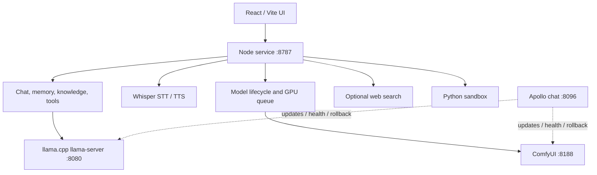

# Current developer system architecture (after 2026-11-03 GPU change)

This page describes the **developer's daily Windows setup** as of early November 2026. It is documentation of a private reference machine, not a public-install guarantee. The Windows installer still selects ROCm / CUDA / Vulkan / CPU from detection; see [INSTALLATION.md](INSTALLATION.md) and [FEATURE_STATUS.md](FEATURE_STATUS.md).

On **3 November 2026** the reference GPU moved from an AMD Radeon RX 6600 8 GB (ROCm) to an NVIDIA GeForce RTX 5060 Ti 16 GB (CUDA 13 / Blackwell). A side-by-side table is in [GPU_COMPARISON.md](GPU_COMPARISON.md). Measured numbers are in [BENCHMARKS.md](BENCHMARKS.md). The separate maintenance agent **Apollo** is documented in [APOLLO.md](APOLLO.md).

## Hardware

| Part | Value |
|---|---|
| GPU | NVIDIA GeForce RTX 5060 Ti, 16 GB VRAM, CUDA 13 (Blackwell) |
| CPU / RAM | AMD Ryzen 5 3600, 32 GB system RAM |
| Bus | PCIe 3.0 |
| OS | Windows 11 x64 |

Tight resource on this PC: **system RAM** (one large LLM at a time) and **shared VRAM** between the chat model and ComfyUI image/video jobs.

## Runtime layout (conceptual)

Paths below are conceptual for a local Lumicos install. Personal usernames and private data directories are omitted.

```text
Lumicos root/
  app/                 Node service (:8787) + React/Vite UI
  engines/
    llama.cpp/         llama-server (:8080); build chosen via models.json llamaDir
    comfyui/           ComfyUI (:8188); started by Lumicos when needed
    whisper-cuda/      CUDA Whisper binaries
    Selene-Voice/      OmniVoice TTS (experimental calls / read-aloud alternative)
    search/            optional web-search helper
    sandbox/           Windows AppContainer Python sandbox
  apollo/              optional maintenance agent (own Node + pinned llama.cpp + Bonsai)
```

Public installer payloads map into a similar layout under the chosen install root (`C:\Lumicos` by default, or `%LOCALAPPDATA%\Lumicos`).

## How the pieces connect



- Every `/api/*` call on the Node service expects the app's local auth header (see app source). External callers are not part of the public installer story.
- Lumicos can auto-start ComfyUI for Image Lab / video work and yields the GPU between chat and image jobs through its compute queue.
- Apollo is **optional** and separate: it must not run its Bonsai brain on the GPU at the same time as Lumicos's primary chat model. Details: [APOLLO.md](APOLLO.md).

## Models and backends (developer daily use)

| Role | Typical choice after the CUDA move | Notes |
|---|---|---|
| Primary chat / agent | Gemma 4 26B A4B QAT Q4_0 + MTP draft | Live profile uses large per-slot context and expert offload (`-ncmoe`); see [BENCHMARKS.md](BENCHMARKS.md) |
| Alternate chat / calls | Gemma 4 E4B (calls skip mmproj) | E2B remains available as a lighter profile |
| Speech-to-text | Whisper on CUDA (Thonburian medium used in migration checks) | Public installer may still offer CPU Whisper |
| Speech output | Microsoft Pattara (public default) and/or OmniVoice (private experiments) | Public docs keep Pattara as the supported default |
| Still images | Z-Image Turbo (NVFP4 health baseline on this PC); Flux 3 Klein / Moss for editing | Image Lab is optional in the installer |
| Video (experimental) | MiniMax H3 Singularity V1.3 (merged turbo LoRA, NVFP4) and LTX 2.5 NVFP4 | Not a certified public installer feature |

The public [model catalog](../catalog/models.json) pins installer defaults (E2B/E4B, Whisper, Z-Image). Larger 26B/MTP and video profiles used on the developer PC are **not** shipped as ready-to-use public profiles.

## Engines after the CUDA move

| Engine | Developer reference (early Nov 2026) |
|---|---|
| llama.cpp | CUDA builds; active production build tracked by Apollo as **b12182** (previous rollback target b12110; migration day used b12032) |
| ComfyUI | PyTorch `2.14.1+cu130`; upstream commit used for RelayVSR work recorded as `e049311` (after a v0.44.0 portable update) |
| Whisper | CUDA build under `engines/whisper-cuda` |
| ROCm | Removed from the daily path on this PC after 2026-11-03 |

## What this page is not

- Not proof that every public installer path was clean-installed on the RTX 5060 Ti.
- Not a license grant for model weights, ComfyUI custom nodes, or third-party runtimes.
- Not an inventory of private personas, voice references, API keys, or chat logs (those stay off this repository).
