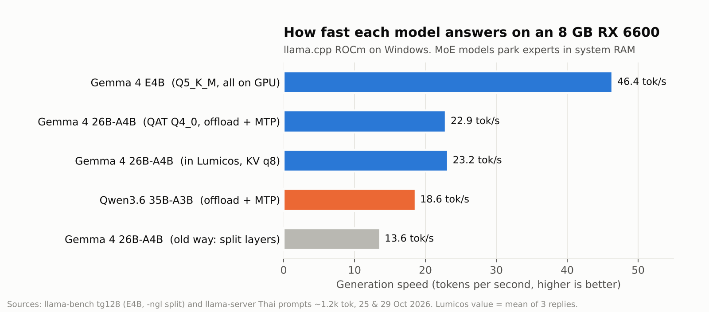
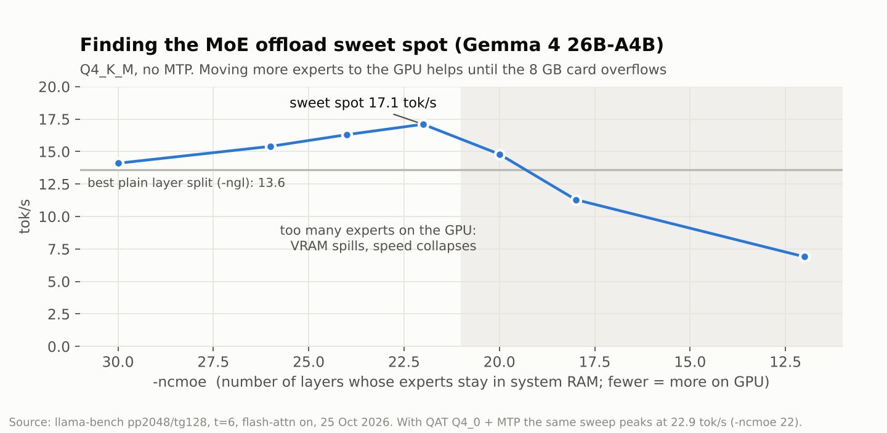

# Developer benchmark archive — not a public release certification

Existing tracked chart sources: [English plotting script](charts/make_charts.py), [Thai plotting script](charts/make_charts_th.py). They preserve numbers previously published from the private daily build on an **RX 6600 8 GB / ROCm** machine (mainly 20–30 October 2026).

On **3 November 2026** that machine moved to an **RTX 5060 Ti 16 GB / CUDA 13**. Newer figures below are paraphrased from local `_bench` notes, migration checks and Apollo baselines on that PC. No private raw logs, prompts, seeds or personal paths are imported into this repository. Figures that were mentioned verbally but not found in the on-disk notes are marked **ไม่มีข้อมูล**.

For the architecture overview see [ARCHITECTURE.md](ARCHITECTURE.md). For a condensed before/after table see [GPU_COMPARISON.md](GPU_COMPARISON.md).

## Shared host (both eras)

Ryzen 5 3600 · 32 GB RAM · Windows 11 · PCIe 3.0.

---

## Era A — RX 6600 8 GB (ROCm), charts through late October 2026

| Measurement | Reported value | Method / configuration shown in source |
|---|---:|---|
| Gemma 4 E4B | 46.4 tok/s | Q5_K_M, GPU; llama-bench tg128 |
| Gemma 4 26B-A4B | 22.9 tok/s | QAT Q4_0, expert offload + MTP; llama-server Thai prompts around 1.2k tokens |
| 26B plain layer split | 13.6 tok/s | llama-bench; different offload setup |
| 26B MoE sweep peak | 17.1 tok/s | Q4_K_M, no MTP, -ncmoe 22, pp2048/tg128, threads6, FA on, 25 Oct |
| Live 26B (handoff, -ncmoe 23, KV q8) | ~22–24 tok/s | Short live chat samples on Lumicos |
| Z-Image Turbo INT8 (warm ComfyUI) | ~26 s | 576×768, direct ComfyUI, ROCm |
| Z-Image inside Lumicos jobs | median ~38–54 s by size | 157 real images, 15–26 Oct 2026; includes queue / loads |

Do not compare mixed llama-bench and server workloads as a controlled speedup. The original logs, complete prompts/seeds, executable hashes and per-repetition timings referenced by the plotting scripts are not included.

### Existing charts (RX 6600 era)

Additional original charts: [coding](charts/03-coding-accuracy.png), [coding settings](charts/04-coding-settings.png), [long context](charts/05-long-context.png), [call latency](charts/06-call-latency.png), [image models](charts/10-image-models.png), [image timing](charts/09-image-generation.png). They retain their original claims and sample sizes; availability of a chart does not establish availability of the model/workflow in the public installer. [Thai chart source and assets](charts/th).

Historical video experiments: [VAE decode](charts/07-video-vae-decode.png), [image-to-video](charts/08-video-i2v-time.png). These are private experiments, not advertised Lumicos video-generation features.

---

## Era B — RTX 5060 Ti 16 GB (CUDA 13), November 2026

### Chat / agent (llama.cpp)

| Measurement | Value | Conditions (as recorded locally) |
|---|---:|---|
| Gemma 4 26B A4B QAT + MTP (early after move) | ~80–85 tok/s | `-ncmoe 4`, ctx 8192, live Lumicos |
| Same family, later live profile | ~82 tok/s | `-ncmoe 5`, 32768 tokens/slot × 2 slots; VRAM ~15.6/16.3 GB with ComfyUI up |
| Apollo llama health baseline | 108 tok/s | Gemma 26B primary profile, Apollo `baseline` health prompt (2026-11-07) |
| Gemma 26B on bugfix2+4 (Apollo A/B) | ~85 tok/s gen; 26/30 | llama.cpp b12110, thinking off, temp 0.2, Lumicos stopped |
| Qwen3.6 35B A3B trial | ~40 tok/s | Dropped: only ~1 GB system RAM free |
| E4B GPU chat tok/s after migration | **ไม่มีข้อมูล** | E4B used for calls; separate CPU translate test ~9 tok/s |

Migration-day server smoke (b12032 CUDA, short prompts) also logged generation rates in the ~22–37 tok/s band depending on prompt length and warm-up; those are not the tuned live 26B profile above.

### Speech

| Measurement | Value | Conditions |
|---|---:|---|
| Whisper CUDA (Thonburian medium) | ~0.60–0.84 s | ~5.1 s Thai audio, flash-attn on, migration check |
| OmniVoice CUDA smoke | ready on RTX 5060 Ti | Migration `production-check` passed; not a latency leaderboard |

### Images (ComfyUI)

| Measurement | Value | Conditions |
|---|---:|---|
| Z-Image Turbo NVFP4 (recorded bench) | 13.9 s wall / 4 s sampling | One `_bench` variant, same prompt/seed family as other still tests |
| Apollo ComfyUI health image | 9.1 s | Baseline stored in Apollo `versions.json` (512px-class health UNet) |
| Image Lab quality still (1 MP, later UI work) | ~6.6 s | One prompt, quality mode without auto-upscale |
| Full Flux/Moss/Qwen NVFP4 latency matrix | **ไม่มีข้อมูล** | Weights installed 2026-11-05; inference matrix deferred while video work ran |

### Video (experimental lab, not public installer certification)

| Measurement | Value | Conditions |
|---|---:|---|
| MiniMax H3 GGUF Q4 + turbo LoRA, 832×480, 124 frames (~5 s) | ~216–245 s warm | Pre-NVFP4 baseline; compute-bound ~25 s/step |
| H3 NVFP4 + runtime LoRA side branch, 864×480 | ~146 s cold | Quality comparable to GGUF+LoRA in notes |
| H3 1344×768 4-step + SOL sparse | ~171–188 s /clip | Four-clip rain story ~171 s each, stable VRAM |
| Singularity V1.3 merged turbo NVFP4 draft 960×544 | ~107 s (sampling ~69 s) | Preferred production route family |
| Film-studio clip (Krea still → H3) | 179.5 s | One recorded campus-love shot |
| LTX 2.5 NVFP4, 960×544, 49 frames + audio | 30 s warm / 58 s cold | ~1.2 s/step; GGUF Q4 ~72–107 s |
| RelayVSR ×2, 1344×768 → 2688×1536, 124 frames | ~18 s warm / ~50 s cold | ~10 GB VRAM |
| Verbal “H3 5 s ≈ 3m49s” | **ไม่มีข้อมูลในไฟล์** | Closest documented band is ~171–245 s depending on route |

### Coding / agent quality samples (same card, CUDA era)

| Suite | Result | Notes |
|---|---|---|
| Agent exam (`_bench/agent1`, 12 offline tasks) | 11/12 after harness work | Gemma 26B; not a public CI job |
| bugfix2 + bugfix4 vs Bonsai (Apollo) | Gemma 26/30; Bonsai 24–26/30 | See [APOLLO.md](APOLLO.md) |

---

## How to read these numbers

- Keep RX 6600 chart figures (**46.4** / **22.9**) when comparing to older posts; they are still the published ROCm archive.
- Prefer same-tool comparisons (live chat vs live chat, ComfyUI wall vs ComfyUI wall).
- Video and Image Lab rows are developer lab results. The public feature table still marks ComfyUI images as experimental and does not certify Resolve or a general video product.
- For a publishable comparison, attach sanitized raw logs, commit/build/runtime and driver versions, GPU/CPU/RAM, GGUF revision/quantization, offload/KV/FA/MTP flags, token counts, cache state, seeds, repetitions and errors.
- Only benchmark an idle authorized GPU; never stop other AI applications without permission.
